# ai-dev-setup

Set up the **Spryker AI Dev SDK** (`spryker-sdk/ai-dev`) in a Spryker project — install the Composer
package, wire its console commands, register the MCP server with whichever coding agent you are
running, and install the project instructions file plus the Spryker coding rules.

Three related flows live in one skill: **first-time onboarding**, **updating** the bundled artifacts,
and **rules only** for a project without a working Spryker environment. The skill infers which one you
want rather than asking, and every step is idempotent — it checks whether its work is already done,
reports the existing state in one line, and fills only the gap.

Everything the skill writes depends on one decision made up front: **which harness is running it.**

## When it triggers

User-invocable only (`disable-model-invocation: true`) — it runs when you ask for it, not on the
model's initiative.

| You say | Flow |
|---|---|
| "install", "set up", "onboard", "add", "configure", "first time", "new project" | onboarding |
| "update", "refresh", "sync", "pull latest", "get newer", "upgrade rules" | update |
| "just the rules", "only the rules", "no setup", "I don't have docker" | rules only |
| bare invocation, no context | resolved from project state |

Onboarding requires **both Composer and a running `docker/sdk` environment**. Updating only needs the
bundled content on disk. Rules only needs neither — which is the point of it.

## Harness detection

Step 0 runs before everything else, cheaply and in order — first match wins:

| Signal | Harness |
|---|---|
| `CLAUDECODE` or `CLAUDE_PROJECT_DIR` set | Claude Code |
| `COPILOT_HOME` set, or `~/.copilot` exists | GitHub Copilot CLI |
| `TERM_PROGRAM=vscode` (and signal 1 did not match) | VS Code Copilot |
| nothing matched | ask the user: Claude Code / GitHub Copilot CLI / VS Code Copilot / other |

Detection is best-effort, so the skill states the result in one line and lets you correct it before
acting — a wrong harness writes the right content to paths nothing reads. The decision goes into
`run.log` alongside the mode decision.

## Per-harness artifacts

Mirrors `TOOL_ARTIFACT_MAP` in `src/SprykerSdk/Zed/AiDev/AiDevConfig.php`.

| Harness | Project instructions file | Rules folder | Rule frontmatter |
|---|---|---|---|
| Claude Code | `CLAUDE.md` at the root | `.claude/rules/<name>.md` | `paths` kept; `name`/`description` dropped |
| GitHub Copilot CLI | `.github/copilot-instructions.md` | `.github/instructions/<name>.instructions.md` | `paths` → `applyTo`; `name`/`description` dropped |
| VS Code Copilot | `.github/copilot-instructions.md` | `.github/instructions/<name>.instructions.md` | same as Copilot CLI |

## MCP registration, per harness

| Scope | Where | Read by |
|---|---|---|
| user-level, Claude Code | `claude mcp add "$(basename "$(pwd)")" -- "$(pwd)/docker/sdk" console ai-dev:mcp-server -q` | Claude Code |
| user-level, Copilot CLI | `copilot mcp add "$(basename "$(pwd)")" -- "$(pwd)/docker/sdk" console ai-dev:mcp-server -q` | Copilot CLI |
| project-scoped | `.mcp.json` at the project root (`mcpServers` key) | both CLIs — **recommended for a shared repo** |
| VS Code | `.vscode/mcp.json` (**`servers`** key, not `mcpServers`) | VS Code only |
| Copilot cloud agent | the repository's Copilot coding agent settings on GitHub | the cloud agent — the skill links, never automates |

The server name is the project folder basename in every branch, and the trailing `-q` is mandatory in
every branch. `.vscode/mcp.json` is not read by Copilot CLI and `.mcp.json` is not read by VS Code, so
a developer who uses both needs both files — the skill says so rather than letting you find out.

## Flow schema

```mermaid
flowchart TD
    A([Invoked]) --> H0["Step 0 — detect the harness<br/>CLAUDECODE · COPILOT_HOME · TERM_PROGRAM<br/>ask if none matched"]
    H0 --> HC["Confirm in one line, log it.<br/>Everything below branches on this"]
    HC --> SA["Signal A — read the user's invocation<br/>install-words vs refresh-words vs rules-only-words"]
    SA --> SB["Signal B — read project state<br/>composer show · instructions file ·<br/>rules folder · mcp list · .mcp.json"]
    SB --> D{"Combine A + B"}

    D -- "A=rules only, or<br/>no Composer / no docker/sdk" --> RO
    D -- "A=update, B=fully set up" --> U0
    D -- "A ambiguous, B fully set up" --> STATE1["State the assumption in one line"] --> U0
    D -- "A=update, B=nothing installed" --> ASK1{"Ask: not onboarded —<br/>run full onboarding instead?"}
    D -- "A=onboarding, B=fully set up" --> ASK2{"Ask: already configured —<br/>refresh artifacts instead?"}
    D -- "A and B disagree otherwise" --> ASK3{"State both signals,<br/>ask which flow"}
    D -- "A=onboarding / ambiguous,<br/>B=nothing or mixed" --> R0

    ASK1 -- "yes" --> R0
    ASK2 -- "yes" --> U0
    ASK3 --> R0
    ASK1 -- "no" --> STOP([Stop — never silently fall through])
    ASK2 -- "no" --> STOP

    RO["Rules-only —<br/>one command: sync-rules.sh --target . --harness X"]
    RO --> ROEND(["Stop. No Composer, no Docker,<br/>no MCP, no console wiring"])

    U0{"Update flow —<br/>instructions file and rules folder<br/>actually present?"}
    U0 -- "missing" --> ASK4{"Looks like a first install —<br/>switch to onboarding?"} --> R0
    U0 -- "present" --> U1["Skip Requirements/Preflight/Steps 1-4<br/>jump to Step 5, default = OVERWRITE<br/>still confirm, never silent"]
    U1 --> UEND([Stop after Step 5 —<br/>report which artifacts refreshed<br/>+ the bundled version])

    R0["Requirements — HARD preconditions"] --> RC{"composer on PATH<br/>AND docker/sdk help works?"}
    RC -- "either missing" --> HALT(["Tell the user what's missing, offer<br/>rules-only, stop. Never run docker/sdk up<br/>or install Composer for them"])
    HALT -.-> RO
    RC -- "both OK" --> P{"Preflight —<br/>composer.json has spryker/* AND<br/>a ConsoleDependencyProvider exists?"}
    P -- "no" --> HALT
    P -- "yes" --> S1

    S1{"Step 1 — composer show +<br/>composer outdated"}
    S1 -- "not found" --> S1I["composer require spryker-sdk/ai-dev --dev<br/>or docker/sdk cli composer require"]
    S1 -- "installed, up to date" --> S1T
    S1 -- "newer available" --> S1A{"Ask before<br/>composer update"} --> S1T
    S1I --> S1T{"src/Generated/Shared/Transfer/AiDev*<br/>present?"}
    S1T -- "no" --> S1G["docker/sdk cli console transfer:generate<br/>success = banner ONLY, nothing else"] --> S2
    S1T -- "yes" --> S2

    S2["Step 2 — find every<br/>*/Zed/Console/ConsoleDependencyProvider.php"]
    S2 --> S2L{"More than one?<br/>which is the LEAF?"}
    S2L -- "one file" --> S2W
    S2L -- "chain calls parent::getConsoleCommands" --> S2W
    S2L -- "a non-leaf skips parent::" --> S2Q{"Ask: wire the leaf directly,<br/>or add the parent:: call?"} --> S2W
    S2W["Per-console pre-check, then add only<br/>the missing import / class_exists-guarded<br/>registration for McpServerConsole +<br/>AiToolSetupConsole. NOT GeneratePromptsConsole"]

    S2W --> S3{"Step 3 — harness mcp list:<br/>entry named after the project basename?"}
    S3 -- "connected" --> S4
    S3 -- "exists but FAILING" --> DEFER["Do NOT re-register.<br/>Defer the decision to Step 4"] --> S4
    S3 -- "absent" --> S3B{"Which scope?"}
    S3B -- "user-level" --> S3A["claude mcp add / copilot mcp add<br/>$(basename $(pwd)) -- $(pwd)/docker/sdk<br/>console ai-dev:mcp-server -q<br/>the -q is mandatory: the banner<br/>would pollute stdio"] --> S4
    S3B -- "shared repo" --> S3J[".mcp.json (both CLIs) and/or<br/>.vscode/mcp.json (servers key).<br/>Ask before writing into the team's diff"] --> S4

    S4{"Step 4 — Verify<br/>docker/sdk cli console | grep ai-dev:<br/>exactly two commands?<br/>mcp entry connected?"}
    S4 -- "consoles missing" --> S2
    S4 -- "deferred entry recovered" --> S5
    S4 -- "entry STILL failing" --> ASK5{"Surface the exact error, ask about<br/>mcp remove + re-register"} --> S5
    S4 -- "all green" --> S5

    S5["Step 5 — artifacts, one consent each<br/>Auto mode does NOT bypass these prompts"]
    S5 --> A1{"Artifact 1 — instructions file<br/>absent / bundled / custom?"}
    A1 -- "absent" --> A1A["Ask, then cp AGENTS.example.md"]
    A1 -- "matches bundled" --> A1B["Ask: overwrite or keep"]
    A1 -- "custom" --> A1C["THREE choices:<br/>keep · overwrite · MERGE (recommended)<br/>append only whole missing sections"]
    A1A --> A2
    A1B --> A2
    A1C --> A2
    A2{"Artifact 2 — rules:<br/>rules folder already<br/>holds the rule files?"}
    A2 -- "yes" --> A2S["Skip — already installed"] --> A3
    A2 -- "no" --> A2R["Ask, then sync-rules.sh<br/>never a plain cp"] --> A3
    A3{"Artifact 3 — stop guard + permissions<br/>plugin install: permissions only"}
    A3 --> FIN(["Final report, 3-5 lines<br/>+ ALWAYS: restart the session<br/>(/exit · restart CLI · reload window)<br/>for the MCP tools to load"])

    classDef step fill:#1f6feb,stroke:#0b3d91,color:#fff;
    classDef decision fill:#f0ad4e,stroke:#8a6d3b,color:#000;
    classDef terminal fill:#2ea043,stroke:#176f2c,color:#fff;
    class H0,HC,SA,SB,R0,S1I,S1G,S2,S2W,S3A,S3J,DEFER,S5,A1A,A1B,A1C,A2S,A2R,U1,RO,STATE1 step;
    class D,U0,RC,P,S1,S1T,S1A,S2L,S2Q,S3,S3B,S4,A1,A2,A3,ASK1,ASK2,ASK3,ASK4,ASK5 decision;
    class A,STOP,HALT,UEND,ROEND,FIN terminal;
```



## What a fully onboarded project has

1. `spryker-sdk/ai-dev` installed as a dev dependency.
2. Two console commands wired in the leaf `ConsoleDependencyProvider` — `McpServerConsole` and
   `AiToolSetupConsole`.
3. The AI Dev MCP server registered with the harness in use, so other sessions in this project get
   Spryker-aware tools (transfers, OMS, module map, CSV/ODS).
4. Optionally the project instructions file at the root, and the coding rules in the harness's rules
   folder — see the artifact table above.
5. On a **setup** install (skills copied in, no plugin): the stop guard (`guard-stop.php` +
   `lib.php`) in the harness's project hooks folder, plus the stop-guard hook and the `permissions`
   block merged into the harness's settings file. A plugin install gets the stop guard from the
   plugin's own hooks file; the skill still offers to merge the `permissions` block.

`ai-dev:generate-prompts` exists in the package but is **outdated** — the skill never wires it, and
flags an existing wiring for removal rather than deleting it silently.

## Design decisions baked in

- **One decision drives the rest.** Step 0 resolves the harness before the mode decision, because the
  mode signals, the MCP registration and the artifact names all depend on it. It is confirmed out loud
  in one line: detection reads environment variables that a wrapper, a `tmux` session, or an unusual
  launch can get wrong, and a silently wrong harness produces a perfectly valid install at paths
  nothing reads.
- **Infer the flow, don't interrogate.** Two signals (what you said, what the project looks like)
  decide the flow. Ambiguity gets a stated assumption you can redirect, not a question — but a genuine
  disagreement between the signals always stops and asks.
- **A missing environment is a flow, not a failure.** No Composer or no running `docker/sdk` used to be
  a dead end. It now routes to rules-only, because a client can install the plugin and want the Spryker
  coding rules without ever standing up a Spryker environment.
- **Idempotency is a per-step contract.** Every step first checks whether its work is already done
  correctly, and if partially done, narrates the gap and fills only the gap. Running the skill twice
  produces the same result and never duplicates a registration or overwrites your changes.
- **The rules may already be there.** The plugin ships them as plugin data under `rules/`, and a
  session-start hook offers to install them. Step 5 counts the files in the rules folder and skips
  the artifact when they are there, rather than asking a question you have nothing to decide.
- **The console and the sync script transform; `cp` does not.** Both drop `name`/`description`,
  and rewrite `paths` → `applyTo` for Copilot, producing identical files. So there is no `cp`
  fallback for any harness: a copied file looks locally edited to the sync script and is never
  refreshed, and under Copilot a `cp`-ed rule with a `paths:` key looks installed and does nothing.
- **Requirements are hard, and remediation is yours.** Composer and a *running* `docker/sdk` are both
  needed for onboarding; the skill stops and tells you what's missing rather than running
  `docker/sdk up` or installing Composer for you — both are state-changing on your machine.
- **Wire the leaf, not `Pyz` by reflex.** Projects often put a project-namespace provider above `Pyz`.
  The class that actually runs is the leaf, and wiring into `Pyz` only surfaces if every override in
  the chain calls `parent::getConsoleCommands($container)`. The skill finds all candidates, identifies
  the leaf, and states in one line which file it edited and why.
- **A failing MCP entry is usually a downstream symptom, not a broken registration.** Step 3 defers
  rather than starting a `mcp remove` / `mcp add` cycle — the same entry typically reports `✓ Connected`
  once Steps 1 and 2 have landed. Only if Step 4 still shows it failing does the skill surface the
  error and ask.
- **The MCP name is the project's folder basename, never a generic one.** Developers with several
  Spryker checkouts on one machine would otherwise collide on a single shared entry in the harness's
  user-level config. The state check greps `^<name>:` — anchored, colon-delimited — because a substring
  match false-positives on an entry whose name merely contains the project basename.
- **`-q` on the MCP command is mandatory.** MCP speaks over stdio, and the `docker/sdk console` banner
  would otherwise break the handshake. This holds in every registration branch, file-based ones included.
- **Overwriting is always a separate, explicit consent.** Auto mode does not bypass Step 5's prompts —
  replacing a custom instructions file or files in the rules folder is destructive. A custom
  instructions file gets three choices, with **merge** (append only whole sections you lack, under a
  `# Spryker AI Dev — bundled additions` divider) recommended. A project-scoped `.mcp.json` gets the
  same treatment, because it lands in the team's diff.
- **Bundled content is pinned to `composer.lock`.** The skill copies what is on disk under
  `vendor/spryker-sdk/ai-dev/data/` — it never fetches from GitHub. For newer artifacts, run
  `composer update spryker-sdk/ai-dev` first, then re-run in update flow. The plugin's own install
  directory is not a substitute source: it points at whichever project loaded the plugin, possibly a
  different one on the same machine.

## Run artifacts

Every run writes a plain-text trail so a completed onboarding can be audited afterwards — created
right after the mode decision (the first thing worth recording), in all three flows. Run the skill
from the project root; the folder is anchored there:

```
.ai-dev/ai-dev-setup/<run-id>/run.log      # <run-id> = UTC start timestamp
```

It records the harness decision and the signal behind it, the mode decision and the two signals behind
it, each Requirements / Preflight check, every step's START/END, the actual
`ConsoleDependencyProvider` path edited, the MCP server name and registration scope, each Step 5
artifact decision, and every hard stop with its verbatim error. Because this onboarder is idempotent,
**a skip is logged as explicitly as an action** (`already installed: … (skipped)`) — a skipped step is
a result, not an absence. Bulk command output goes to `<step>.log` beside it, keeping `run.log` to one
line per outcome.

The final report's last line is the absolute path to that folder.

## Output

A 3–5 line final report: the harness, package + version installed, which provider file was edited and
how many consoles were added, the MCP server name and scope used, and one status per artifact
(`added` / `overwritten` / `merged: …` / `skipped` / `failed: …`) with the actual paths written.

It always ends with the same reminder: **restart the session** — `/exit` and reopen in Claude Code,
quit and restart the Copilot CLI, or reload the window in VS Code. The running session loaded its MCP
servers at startup and will not pick up the new one. It also suggests two optional additions: a PHP
language server for the harness in use, and a Context7 MCP server for Spryker documentation.

The report also closes with two short blocks, phrased as offers rather than obligations:

- **What onboarding changed, and that it blocks nothing.** Onboarding necessarily dirties the clone —
  tracked `composer.json`, `composer.lock`, the edited `ConsoleDependencyProvider.php`, plus `.mcp.json`
  when one was written; untracked instructions file, rules folder, `.ai-dev/`. The report names them
  and states that every skill tolerates them uncommitted: `project-starter-wizard` recognises this exact
  shape in its §0 pre-flight and proceeds. Committing is optional housekeeping mentioned in passing,
  never a precondition.
- **A recommendation for what to do next**, naming the entry points without starting any of them:
  `/spryker-ai-dev-sdk:project-starter-wizard` for a new project;
  `/spryker-ai-dev-sdk:spryker-customization` (or `…:product-requirement-document` first) for feature
  work on an existing one — both only usable after the session restart. The skill recommends; the user runs.

## What it escalates instead of forcing

- An undeterminable harness the user cannot name — stop rather than guess a layout and write files
  where nothing will read them.
- A `composer require` version conflict — surfaced, never force-installed with `--ignore-platform-reqs`
  or `-W` unasked.
- A missing or unparseable `ConsoleDependencyProvider.php` — stop and ask where to wire; never invent
  a file.
- A CLI without an `mcp add` subcommand — offer the project-scoped JSON snippet rather than failing
  silently.
- A missing Composer or a `docker/sdk` that is not up — offer rules-only rather than stopping flat.

## Packaging note

This skill ships in the `spryker-ai-dev-sdk` plugin under `vendor/spryker-sdk/ai-dev/…`, which is
Composer-managed — `composer update spryker-sdk/ai-dev` may overwrite it. The durable home for edits
is the plugin's own repository (`github.com/spryker-sdk/ai-dev`).
