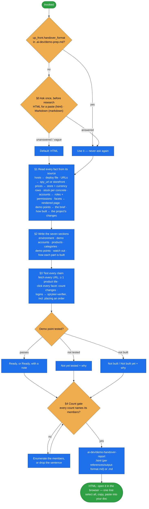

# demo-run-sheet

Produce the **demo handover report**: the document the presenter opens on a second screen during the
call, and the team takes over with the demo. Environment and links, demo accounts, products,
categories, one demo point per requirement of the brief with its status, what to watch out for, and
how each part is built.

It is the last phase of [demo-prep-wizard](../demo-prep-wizard/README.md). Two rules govern it: the
demo points come **from the brief**, one row per requirement, and **nothing in the report is
composed, inferred or remembered** — every line is read from the running system and tested before it
ships.

## When it triggers

"Handover report", "demo cheat sheet", "run sheet", "what do I show", "give me the links and logins
for the demo", "prepare for the customer call" — and phase 7 of the demo-prep wizard.

## Flow schema

## The sections, in the order a presenter reads them

| section | carries |
|---|---|
| **1. Environment** | storefront per store, Back Office, any other app the demo touches — each a fetched, clickable link, with the `/<STORE>/<lang>/` prefix stated; what to set before the call |
| **2. Demo accounts** | per account: person, login, company / role, what it is **for** and what it must **not** be used for. No password: how it is handed over |
| **3. Products** | per product: link, the point it makes, stock per warehouse with out-of-stock variants named, list vs the persona's price |
| **4. Categories** | per category: link, products actually visible (counted from tiles), the facets that narrow the result |
| **5. Demo points** | one row per requirement of the brief, grouped and ordered as the brief: how to show it and its status (`Ready`, `Ready, with a note`, `Not yet tested`, `Not built yet`, `Not built`) |
| **6. Watch out during the demo** | everything found while testing that would derail a live run, each with what to do instead |
| **7. How each part is built** | per feature: `Standard`, `Configured`, `Custom`, `Custom (small)`, `Custom (mocked)` or `Content page only (mocked)`, and what |

## Files

| file | holds |
|---|---|
| `SKILL.md` | the format question, the source table for every fact, the seven sections, the test rules, the count gate, scope, the Markdown template, the close checklist, pitfalls |
| `references/output-format.md` | the paste contract, which HTML survives a rich-text paste and which does not, the HTML template with the status labels |

## Design decisions baked in

- **Ask the format once, first: Markdown or HTML.** A Markdown table pasted into a document arrives
  as rows of pipe characters, so a paste into a document gets HTML with inline styles and absolute
  URLs only. A format complaint changes the format of the next file, not its wording.
- **Every requirement of the brief has a row.** What does not work keeps its row with its status and
  the reason.
- **`Ready` means tested.** Built and not tested is `Not yet tested`.
- **No URL is composed.** Slugs are generated from localized names and are not derivable from keys or
  titles; every URL is read from the url table or copied from the storefront, then fetched.
- **A 200 alone does not pass.** A category page renders 200 with zero products, and its `N Items`
  string is unreliable — product tiles are counted instead.
- **A role's name does not prove its permissions.** Every account a demo point asks to transact
  completes the path, order placed, through the [spryker-verifier](../../agents/spryker-verifier.agent.md)
  agent — a verifier FAIL is cross-checked against persisted state first.
- **Stock is per concrete.** Out-of-stock variants of every demoed product are named.
- **How each part is built is read from the project's changes**, so the team that takes over knows
  what is Spryker and what it maintains.

## Output

`up_front.handover_format` is `html` or `markdown`. `html` (the default) writes
`.ai-dev/demo-handover-report.html`, opened in the browser for select-all → copy → paste; `markdown`
writes `.ai-dev/demo-handover-report.md`. The wizard marks `demo-run-sheet` → `done` in its state file
only once that file exists.

## Packaging note

This skill ships in the `spryker-ai-dev-sdk` plugin under `vendor/spryker-sdk/ai-dev/…`, which is
Composer-managed — `composer update spryker-sdk/ai-dev` may overwrite it. The durable home for edits
is the plugin's own repository (`github.com/spryker-sdk/ai-dev`).
