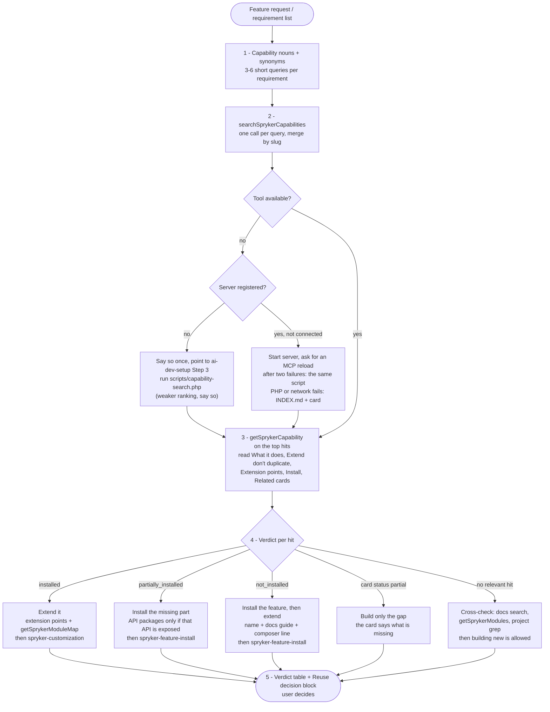

# find-existing-capability

The **reuse gate** for Spryker feature work: before anything new is designed or built, find out whether Spryker already ships it, and whether the project already has it.

Agents in Spryker projects tend to build a new module for something a package already provides. Searching `vendor/` only finds what is installed and what you already suspect. This skill searches the **capability map** instead - 590 cards, one per shipped Spryker capability - and reads the project's `composer.lock` to say what is installed, partly installed or missing.

It is report-only. It recommends; it never installs or edits anything.

## When it triggers

At the start of any feature work in a Spryker project: "build / add / implement X", "we need a system for X", "new module for X", scoping a PRD, "is there something in Spryker for X", "extend X", and when a customer requirement list or briefing has to be mapped to what Spryker offers. It is not for changing one already-identified behaviour (that is `spryker-customization` or `spryker-bugfix`).

## Flow schema

## Tools

Matched by tool name (server names are install-specific): `searchSprykerCapabilities`, `getSprykerCapability`, `getSprykerModuleMap`, `getSprykerModules`, `searchAlgoliaDocumentation`. Without the MCP server the skill first checks whether the server is registered at all (`.mcp.json`, `.vscode/mcp.json`, the harness's list); if not, it points to `ai-dev-setup` Step 3 once and skips the start-and-reload loop. The fallback is the bundled `scripts/capability-search.php`, which reads the published `index.json` (cached 24 h; `--index` or `CAPABILITY_MAP_INDEX_URL` for a mirror or a local file), searches it and prints the same fields as the tool, with `installStatus` computed from `composer.lock`; its ranking is simpler than the tool's. Only when PHP or the network fails does it fetch `INDEX.md` and `<slug>.md` from `https://spryker-capability-map.s3.eu-central-1.amazonaws.com/` and compare the card's packages to `composer.lock` by hand.

## Output

A verdict table (requirement, capability and card, verdict, next step) and one **Reuse decision** block per capability: capability, verdict, evidence, "may already cover this" (an installed card matching through its title or synonyms, e.g. `shopping-list` for a wishlist request), existing project wiring (plugins, routes, widgets already tied to the card's modules), next step, and the card link `https://spryker-capability-map.s3.eu-central-1.amazonaws.com/<slug>.md`.

## Design decisions baked in

- **Reuse before build.** A shipped capability is extended or installed, not rebuilt; a PRD for it reads "configure / extend / install X".
- **A miss is not proof of absence.** A map miss triggers a docs search, a module check and a project grep; "Spryker has no X" is never claimed from the map alone.
- **Cards describe the latest release.** On an older project, the installed code is checked before a card detail is relied on, and `spryker-upgrade` is suggested when the project is behind.
- **Report-only.** Installing is `spryker-feature-install`, building is `spryker-customization`, and the user chooses.
