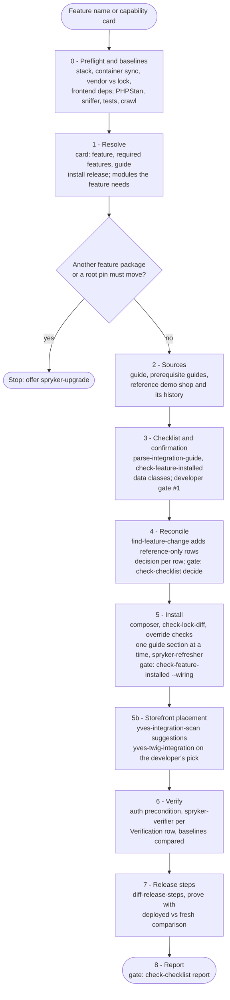

# spryker-feature-install

Install a Spryker feature into a project **end to end**, from a capability card or a feature name:
resolve the feature, its required features and the release it needs; turn the official install guide
into a checklist with one row per step; reconcile each row with the reference demo shop; apply it in
the project layer; suggest storefront placement; verify; and prove the release steps that existing
environments need.

Where `find-existing-capability` decides "install it instead of building it", this skill does the
install — always after the developer confirms the feature, packages, release and optional
integrations.

## When it triggers

"Install the X feature", "add `spryker-feature/x`", "integrate feature X", "install the X Glue API",
after `find-existing-capability` proposed an install (`not_installed` / `partially_installed`), or a
feature that `spryker-upgrade` Phase 6 accepted.

## Flow schema

## Scripts

`$FI` in every example is `<skill-dir>/scripts`. Run the scripts from the project root;
`SPRYKER_PROJECT_ROOT` overrides it. All run on host PHP, with no Spryker bootstrap.

| Script | Phase | What it answers |
|---|---|---|
| `parse-integration-guide.php` | 3 | which steps does the guide have, of which kind, in which scenario? |
| `check-feature-installed.php` | 3 (`--mark`), 5 (`--wiring`) | which modules and wiring does the project have already; is the decided wiring in place; which plugins belong to modules the project does not install? |
| `find-feature-change.php` | 4 | which pull request brought the feature into the reference demo shop, and which of its files does no row name? |
| `check-checklist.php` | 4 (`--phase decide`), 8 (`--phase report`) | is every row decided; is every row done and every verification passed? |
| `check-lock-diff.php` | 5 | which packages did the install move outside the feature's dependency tree; does a required package have a dev constraint? |
| `glossary-key-check.php` | 5 | which translation keys of the feature's Yves modules have no glossary row? |
| `diff-release-steps.php` | 7 | which commands, imports, republishes and variables does the deploy recipe not cover? |

`lib.php` is the shared library. `feature-install.test.php` is the maintainer test suite
(`php $FI/feature-install.test.php`); its guide fixtures in `fixtures/guides/` are copies of real
integration guides in both guide styles. It is not part of an install run. The baselines and the
override checks reuse `../spryker-upgrade/scripts/`; storefront placement uses
`../yves-twig-integration/scripts/`.

## State

Everything a run writes is in the project, under `.ai-dev/feature-install/<feature-slug>/`:

| Path | Content |
|---|---|
| `state.md` | The phase table: phase, status, evidence; the install release and added modules |
| `sources/` | The guides, the feature `composer.json`, the reference demo shop clone and its history |
| `checklist.json` | One row per guide step, with its decision, status and verdict |
| `composer.lock.before` | The lock before the install |
| `baseline/` | The baselines of the `spryker-upgrade` scripts, PHPStan, sniffer and tests |
| `data-handoff-<section>.md` | The fixed row lists for `project-data` |
| `release-steps.md` | The release-steps log |
| `report.md` | The report |

## The checklist row

| Field | Content |
|---|---|
| `id`, `guide`, `section`, `lines` | Where the step comes from |
| `kind` | `composer`, `config`, `schema`, `event`, `transfer`, `oms`, `navigation`, `glossary`, `data-row`, `data-import`, `plugin`, `route`, `widget`, `queue`, `search-index`, `frontend`, `code`, `recipe`, `deploy`, `console`, `verification`, `linked-guide`, `unknown` |
| `tag` | `required`, `optional-scenario:<name>`, `demo-data`, `fresh-install-only` |
| `data_class` | Data rows only: `feature-data`, `project-content`, `demo-data`, or null until decided |
| `target` | The file, the command, the plugin class, or the linked page |
| `plugins`, `packages`, `env` | The plugin classes a snippet wires, the packages a composer line requires, the environment variables a snippet reads |
| `source` | `guide`, or `reference-only` for a file only the reference demo shop changed |
| `reference` | `same`, `differs` or `absent`, with the reference path |
| `decision` | `apply-guide`, `apply-reference`, `merge`, `already-present`, `skip:<reason>` |
| `status` | `open`, `done`, `skipped`, `failed` |
| `verdict`, `verdict_note` | Verification rows: `PASS`, `FAIL`, `BLOCKED`, or `ACCEPTED` with the note |

A plugin row with a class name as its `target` and a `note` comes from a plugin table that has no
wiring snippet in the guide: the guide lists the plugin and shows nowhere how to wire it.

## Design decisions baked in

- **Confirm before changing.** Nothing is required or edited before the developer agrees to the
  feature, release, constraint and optional integrations.
- **Every step is a row; every row is decided.** The checklist gates block the install and the
  report while a row is undecided or open.
- **The reference demo shop decides the plugin subset and order; the project decides its config.**
  The reference is `b2b-demo-marketplace` for every project type; plugins of capabilities the
  project does not have are skipped.
- **The release the feature needs, not the latest.** The feature may move the modules it needs;
  another feature package or a third-party root pin means an upgrade.
- **The guide is the source of truth for steps; the installed code for names.**
- **Project layer only.** Never `vendor/`, `src/Generated/` or `src/Orm/`.
- **Release steps are proven.** A command the guide runs locally is a release step until a recipe
  covers it.
- **Blocked is not failed.** A failed fixture login makes logged-in checks BLOCKED (environment).
- **No destructive commands, no auto-commit.**
