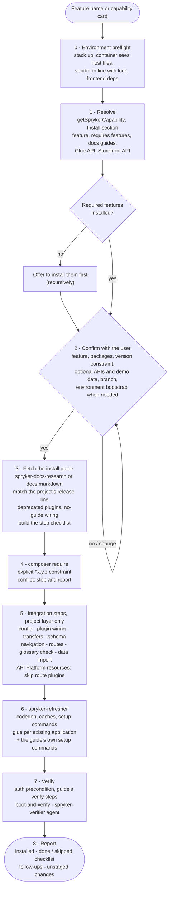

# spryker-feature-install

Install a Spryker feature into a project **end to end**, from a capability card or a feature name: resolve the feature and its required features, confirm scope, fetch the official install guide, `composer require`, apply the guide's integration steps in the project layer, run codegen and setup, verify, and report what was done and skipped.

Where `find-existing-capability` decides "install it instead of building it", this skill does the install - always after the user confirms the feature, packages, version constraint and optional integrations.

## When it triggers

"Install the X feature", "add `spryker-feature/x`", "integrate feature X", "install the X Glue API", or after `find-existing-capability` proposed an install (`not_installed` / `partially_installed`).

## Flow schema

## Tools

Bundled: `scripts/glossary-key-check.php` (translation keys of a feature's Yves modules missing from the project glossary) and `references/environment-preflight.md` (shared with `spryker-upgrade`). Matched by tool name: `searchSprykerCapabilities`, `getSprykerCapability`, `searchAlgoliaDocumentation`, `getSprykerModules`, `getSprykerModuleMap`, `getTransferStructureByName`. Skills it hands to: `spryker-docs-research`, `spryker-refresher`, `boot-and-verify`, `project-data` / `data-import`; agents: `spryker-verifier`, `spryker-issue-diagnoser`.

## Output

A feature install report: what was installed (packages, versions, required features), the guide followed, the step checklist with `done` / `skipped (reason)`, verification evidence, follow-ups (for example the Glue API integration not done) and the changed files, left unstaged.

## Design decisions baked in

- **Confirm before changing.** Nothing is required or edited before the user agrees to the feature, constraint and optional integrations.
- **The guide is the source of truth for steps; the installed code is the source of truth for names.** Identifier spellings are confirmed against `vendor/` (read-only) before they are written.
- **Project layer only.** Never `vendor/`, `src/Generated/` or `src/Orm/`; existing plugin stacks keep their order.
- **Preflight the environment.** A stack that is down, out of sync or behind `composer.lock` is reported as a pre-existing issue and a bootstrap is suggested in the confirmation; never `reset`.
- **Glue applications are resolved, not assumed.** `glue` commands run per application that exists (`public/Glue*/index.php`, deploy entry points); API Platform resources replace the guide's route and relationship plugins.
- **No silent gaps.** Every guide step ends done or skipped with a reason; a failing step is diagnosed, not dropped.
- **No destructive commands, no auto-commit.** A rebuild (`docker/sdk up`) or `reset` is reported, not run; the environment bootstrap is proposed in the confirmation and `reset` never.
- **Blocked is not failed.** When a fixture login fails, logged-in checks are reported BLOCKED (environment) and handed to `spryker-issue-diagnoser`.
