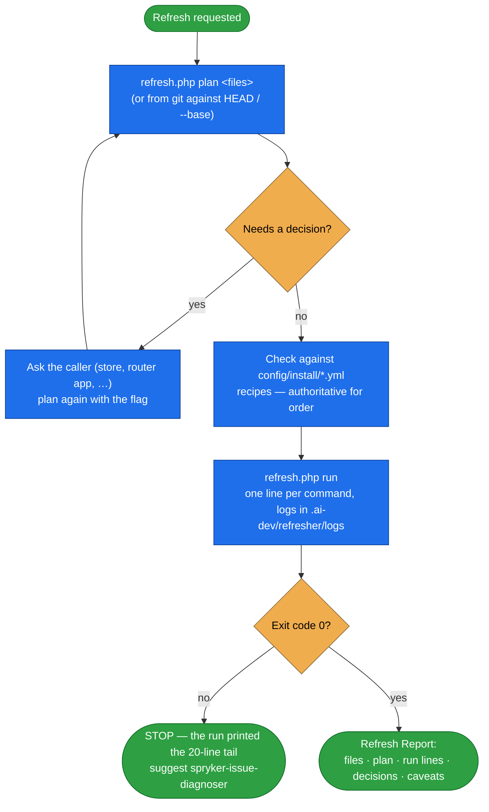

# spryker-refresher

**Makes just-applied changes active.** Given a list of touched files, it derives the post-change
console-command chain — codegen, cache clears, autoload, warmups, frontend builds — runs it in
dependency order, and reports exit codes.

Spryker caches and generates a lot: transfers, Propel classes, the class-resolver map, Twig, navigation,
routes, REST validation, search source maps. Edit a file and nothing happens until the right command
runs. This skill owns the file-pattern → command mapping so the chain is surgical (only what your change
set needs) rather than a full install run.

## When it triggers

"Run post-change commands", "refresh after edits", "regenerate transfers", "rebuild the frontend",
"clear caches after this change", "warm up the caches", "what do I need to run after changing X", "make
these changes take effect". Typical jobs: *"I just touched a transfer XML — refresh"*, *"I edited a
schema XML"*, *"I touched some Twig and a Yves controller"*, *"I added a new plugin registration"*.

**Not for:** editing code (read-only on source), judging whether a change is *correct*, destructive
commands (anything from a `destructive*.yml` recipe, anything that drops/truncates/wipes data or storage,
`docker/sdk reset`), or running the whole install chain.

## Flow schema

## The script

`scripts/refresh.php` holds the file-pattern → command mapping as data, in one place:

| Call | What it does |
|---|---|
| `php refresh.php plan [<file>...]` | Matches each changed file (a path, or `A:` / `M:` / `D:` / `R:<old>-><new>`; default: git working tree against `HEAD`, `--base <ref>`) to the mapping rows and prints the commands in run order, each with its reason, plus manual, decision and skipped items. Writes `.ai-dev/refresher/plan.json`; `--print-only` writes nothing. Flags: `--store`, `--router`, `--symptom`, `--deploy-file`. |
| `php refresh.php run [--from <n>]` | Runs the plan through `docker/sdk`, each command as its own process, full output in `.ai-dev/refresher/logs/`, one line per command; stops at the first non-zero exit with the last 20 log lines. Rebuilds every command from the mapping, so nothing outside it runs. Container checks: `console list` before an importer or `translator:generate-cache`, `/data/node_modules` before the Yves build (else `docker/sdk up --assets`), the dependencies of changed vendor `package.json` files before a frontend build. |
| `php refresh.php table` | Prints the mapping and the run order. |

The lookups the script does: the project namespaces (`config_default.php`), whether a project class
overrides a vendor class, whether a module directory is new (not in the base commit), the Glue
applications (`public/Glue*/index.php`, cross-checked with the deploy file), whether
`src/Generated/Api/<App>` exists, a DMS project (`SPRYKER_DYNAMIC_STORE_MODE`), the modules a
`composer.lock` change moved, and from a CSV diff whether rows were only added.

Run order: 1 cache removes → 2 codegen → 3 autoload → 4 IDE/locator stubs → 5 cache builds/warmups →
6 class-resolver build → 7 data imports → 8 frontend builds → 9 phpstan result-cache clear.

Tests: `php scripts/refresh.test.php` (a fixture project and a stub in place of `docker/sdk`).

## Knowledge sources — discover, don't assume

| Source | Role |
|---|---|
| `config/install/*.yml` | The canonical sequences this project actually runs — source of truth for spelling, flags, ordering. Read before improvising. |
| `docker/sdk console list` | Live truth for which commands exist in the running stack. |
| `searchAlgoliaDocumentation` / `docs.spryker.com` | Fallback when a command's purpose isn't obvious. |
| `git diff` against `HEAD` (or `--base`) | `refresh.php plan` derives the touched-file list from it when the caller didn't enumerate it. |

## Output

A **Refresh Report**: files touched, the plan, the run script's lines (number, command, exit code, log
file), the failure with the 20-line tail the run printed and the suggested next step, open decisions,
and Caveats — the plan's manual items, such as a queue-worker restart or a storefront hard refresh.

## Design decisions baked in

- **One source for the mapping.** The table lives in `scripts/refresh.php` as data; `table` prints it.
  `config/install/*.yml` stays authoritative for this project's ordering and flags.
- **Exception: Glue applications come from the project.** Install recipes list steps for applications the project may not run (the demo shop has no `GlueStorefront` entry point; the storefront API runs in `Glue`). The script lists `public/Glue*/index.php`, cross-checks the deploy file's `entry-point: Glue*` or `application: glue*` and reports other steps as `skipped (no such Glue application)`. `glue` runs via `docker/sdk cli`, not `docker/sdk console`.
- **Surgical, never the full chain.** Only the commands the actual file list demands.
- **One process per command.** The run captures every step's exit code and log individually.
- **Stop on the first failure.** Dependents are not skipped-over — the run stops and the caller decides
  retry vs. hand-off to `spryker-issue-diagnoser`.
- **`cache:class-resolver:build` is easy to miss.** Without it, a project override lands while
  Spryker keeps resolving to the vendor class. The plan adds it for every `.php` change under a project
  namespace.
- **No `cd` prefixes in Bash.** The harness already runs from the project root; a `cd` shifts the command
  onto a different permission-allowlist pattern and triggers prompts.

## Packaging note

This skill ships in the `spryker-ai-dev-sdk` plugin under `vendor/spryker-sdk/ai-dev/…`, which is
Composer-managed — `composer update spryker-sdk/ai-dev` may overwrite it. The durable home for edits
is the plugin's own repository (`github.com/spryker-sdk/ai-dev`).
