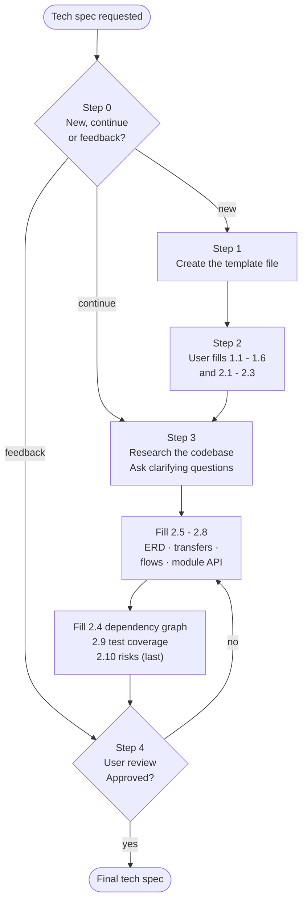

# technical-specification

Create a **technical specification (tech spec)** for a new Spryker feature, together with the user. The
input is a PRD or the business requirements of the user. The output is one Markdown file with Mermaid
diagrams and module API signatures. The file contains no implementation code.

A PRD tells WHAT to build and WHY. The tech spec tells HOW the feature fits into the Spryker
architecture: which modules change, which plugins and extension points the feature uses, which tables
and transfers it adds, and how the data flows. Use the approved tech spec as the reference for the
implementation.

## When it triggers

The user asks for a tech spec or a technical design document for a new Spryker feature
(`/spryker-ai-dev-sdk:technical-specification`). The `spryker-customization` skill also starts it at
Step 0c (MVP only), when the user wants a reviewed tech spec before the build. The approved tech spec is
then a design input for the solution design and the build.

Feature path: `product-requirement-document` → `technical-specification` (optional) →
`spryker-customization`.

**Not for:** business requirements (use `product-requirement-document`), implementation, task
breakdown, or a build order.

## Flow schema

## Files

| File | Role |
|---|---|
| [`SKILL.md`](SKILL.md) | The workflow (Steps 0 - 4), the storage and delivery rules, and the content rules. |
| [`technical-spec-template.md`](technical-spec-template.md) | The tech spec template with the sections for the user and for the assistant. |
| [`module-dependency-graph.md`](module-dependency-graph.md) | Rules for the module dependency graph (section 2.4): relation types, release types, no self-references, color codes. |
| [`erd.md`](erd.md) | Rules for the database ERD (section 2.5). |
| [`transfer-model.md`](transfer-model.md) | Rules for the transfer domain model diagram (section 2.6). |
| [`flow-diagram.md`](flow-diagram.md) | Rules for the flow (sequence) diagrams (section 2.7). |

## Critical requirements

- **User input first.** The user fills the business and context sections before the assistant
  designs the architecture.
- **Mermaid only.** All diagrams use Mermaid. No schema or transfer `.xml` in the spec.
- **Real names.** Each method name in a diagram or in section 2.8 comes from the code or from the new
  API in section 2.8.
- **Release types.** The module dependency graph shows the expected release type of each new or
  changed module.
- **Test coverage outline.** Section 2.9 lists the tests. Functional tests of the public API come first.
- **Risks last.** Risks and Open Questions is always the last section.

## Output

One file for each ticket. The default path is
`resources/plan/tech-spec/<Domain>/<TICKET>-<feature-name>-tech-spec.md`. The project can choose a
different location.
