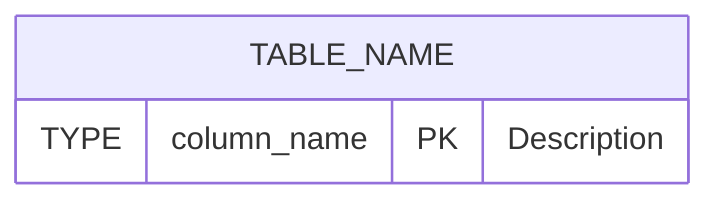
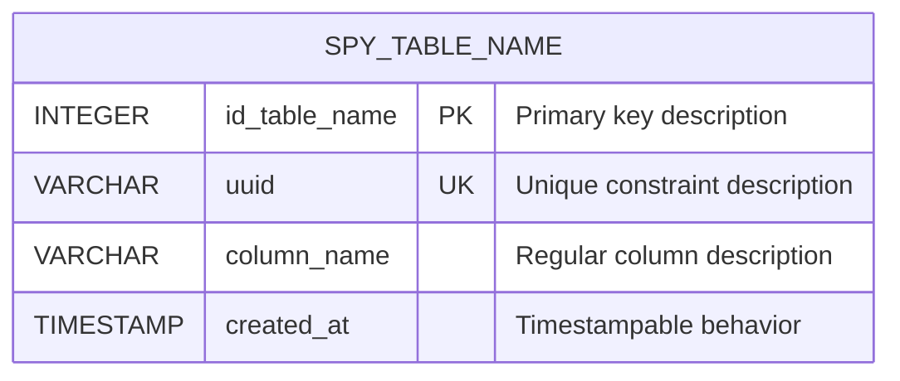
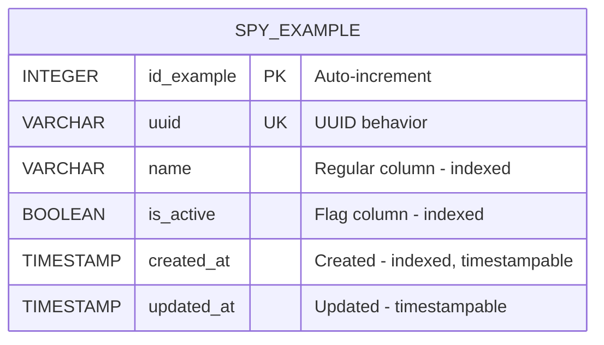

# Entity Relationship Diagram (ERD) Guidelines

## Purpose

Create database schema diagrams in Mermaid ERD syntax for a Spryker technical specification. An ERD shows:
- The database table structure
- The column names, types and constraints
- The primary keys and the unique constraints
- The indexes and the behaviors
- The relations between tables, if the feature has relations

## Output Format

- Do not add the schema `.xml` to the specification. The ERD is the definition. Write only the schema file path for each module, and short notes for constraints and behaviors below the diagram.
- Embed the diagram as a `mermaid` block in section 2.5 of the technical specification, or put it in a `.mmd` file.
- Create one ERD for each database schema or feature.

## Diagram Structure

### Mermaid Configuration

Start each diagram with `erDiagram`:



### Entity Definition



**Naming conventions:**
- Table names: uppercase with underscores (for example `SPY_PRODUCT_REVIEW`)
- Column names: lowercase with underscores (for example `id_product_review`)
- Table prefixes: use `spy_` for core tables and `pyz_` for project tables

### Supported Key Types

The Mermaid ERD syntax supports only these key markers:

- **PK** - Primary key
- **UK** - Unique key
- **FK** - Foreign key

**IMPORTANT:** Do not use custom markers, for example `IDX` (index). They cause parse errors.

### Column Syntax

```
TYPE column_name KEY "Description with metadata"
```

**Examples:**



**Column description rules:**
- Keep each description short (less than 70 characters).
- Add the index information: "Column name - indexed".
- Add the behavior information: "UUID behavior", "timestampable".
- For a timestamp with more than one attribute, write: "Created - indexed, timestampable".

### Supported Data Types

Use these Propel data types in the ERD:

- `INTEGER` - Integer numbers
- `BIGINT` - Large integers
- `VARCHAR` - Variable-length strings
- `LONGVARCHAR` - Long text (TEXT in MySQL)
- `BOOLEAN` - True or false flags
- `DECIMAL` - Decimal numbers
- `TIMESTAMP` - Date and time
- `DATE` - Date only
- `TIME` - Time only
- `BLOB` - Binary data
- `JSON` - JSON data (use `LONGVARCHAR` with a note)

## Constraints

- Do not add explanatory text around the diagram.
- Put the important information in the diagram labels.
- Below the diagram, write only the schema file paths and the short notes from "Output Format".
