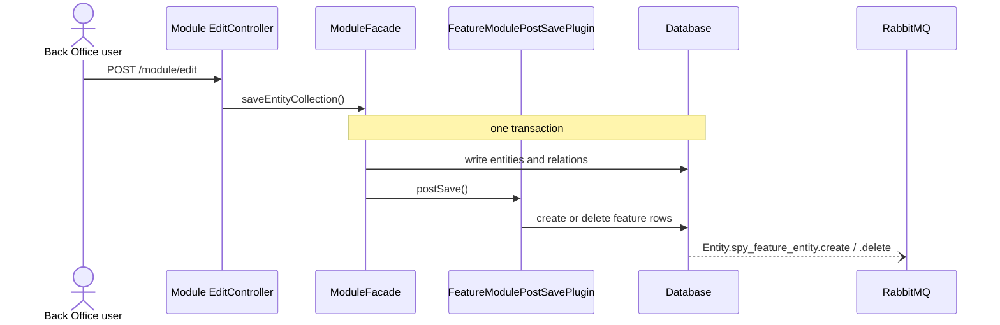

# Flow (Sequence) Diagram Guidelines

## Purpose

Create data flow diagrams in Mermaid `sequenceDiagram` syntax for section 2.7 of a Spryker technical specification. A flow diagram shows:
- Which plugin calls which Facade, Client, Service or Config method, and which Controller or Console command starts the flow
- Each call that leaves the application: Yves or Glue to Zed through the Gateway, and calls to external systems
- Each storage access at a high level: Database, Key-value store (Redis), Search (OpenSearch), Queue (RabbitMQ), File storage

## Output Format

- Create one `sequenceDiagram` for each flow (for example: page load, save, async processing, data import).
- Put a heading `#### 2.7.N <Flow name>` above each diagram.
- Write a maximum of 2 lines of text below a diagram. Put other details in section 2.8.

## Participants

**Show only the important components.** Use a maximum of 10 participants in one diagram.

| Show | Participant label |
|---|---|
| Entry point | `ModuleName ClassName` — Controller, Console command, Queue worker, Glue resource, actor |
| Plugin | The full plugin class name: `<Feature><Module>PostSavePlugin` |
| Module API | `<Module>Facade`, `<Module>Client`, `<Module>Service`, `<Module>Config` — for example `ProductFacade`, `ProductStorageClient`, `UtilEncodingService` |
| Gateway | `Zed Gateway` — Yves or Glue to Zed through `ZedRequestClient` |
| External system | The product name with `(external)`: `Payment provider (external)`, `File host (external, HTTP)` |
| Storage | One participant for each storage type: `Database`, `Redis`, `OpenSearch`, `RabbitMQ`, `File storage` |

**Do not show:**
- Business models (Reader, Writer, Mapper, Validator, Expander classes), Factory, DependencyProvider, Repository, EntityManager. Show their effect as a call on the Facade or plugin that owns them, or as a storage access.
- Transfer objects as participants.
- Framework internals (Symfony form, Propel, event dispatcher). Exception: show the event behavior that sends an event to the queue.

Exception: when the flow has no Facade or plugin (for example, a data import step), show the one class that owns the flow, with its full name.

## Mermaid Compatibility

**CRITICAL:** The diagrams must render in Mermaid 12 viewers. Obey these rules:
- Do not use `box` groups.
- Do not use ` ` in participant labels. Write the label on one line.
- Do not use `:` in participant labels. Write `Queue worker`, not `queue:worker`.

Put the participants in this order from left to right: actor or entry point, application components, storages, external systems. Mark each external system with `(external)` in its label.

## Messages

| Call | Arrow | Label |
|---|---|---|
| Method call | `->>` | `ClassName::method()`, or `method()` when the target participant is the class. Use the real method name. |
| Gateway call | `->>` | `ZedRequestClient: /module/gateway/action` |
| External call | `->>` | The protocol and the operation: `HTTP GET file URL`, `<Vendor>ApiClient::<operation>()` |
| Storage access | `->>` | What the call does, not how: `read active rows (1 query)`, `write pending rows`. No SQL, no Redis keys, no index names. |
| Async message or event | `--)` | The event or queue name: `Entity.spy_x.create`, `<queue_name>` |
| Return | `-->>` | Only when the returned data is important for the flow. |

**Storage rules:**
- Show one message for each storage step in the flow, not one message for each query.
- Write the number of queries in parentheses when it is a requirement (for example `(1 query)` from an NFR).
- Show a transaction with `Note over A,B: one transaction` or with `rect`.

**Branches:** Use `alt` / `else` only when the branch changes the participants that get calls. Use `opt` for a step that the flow can skip.

**Size:** Use a maximum of 15 messages in one diagram. If the flow is larger, split it into 2 diagrams at an async boundary (queue or event).

## Verification

**CRITICAL:** Read the class or the `*Interface.php` file of each participant before you write its method name. Do not write a method name that you did not see in the code or in section 2.8. A diagram is a contract for the implementation, the same as section 2.8.

## Example

The example uses placeholders. Replace `<Module>` and `<Feature>` with the real names.

## Checklist

- [ ] Each participant is an entry point, plugin, Facade, Client, Service, Config, Gateway, external system or storage type.
- [ ] No Reader, Writer, Mapper, Repository, EntityManager or Factory participant (except the exception above).
- [ ] Each plugin and API call shows the real class and method name.
- [ ] Each Gateway and external call goes to a separate participant. External systems have `(external)` in the label.
- [ ] No `box`, no ` ` and no `:` in participant labels.
- [ ] Each storage step is one message that tells what it does.
- [ ] Maximum 10 participants and 15 messages.
- [ ] All method names are in the code or in section 2.8.
