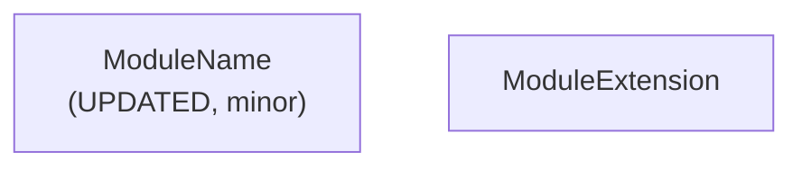
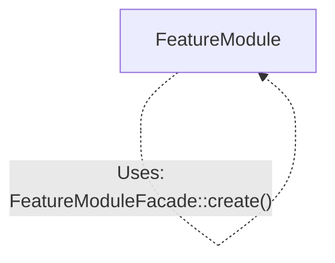
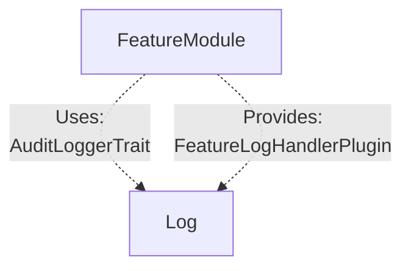
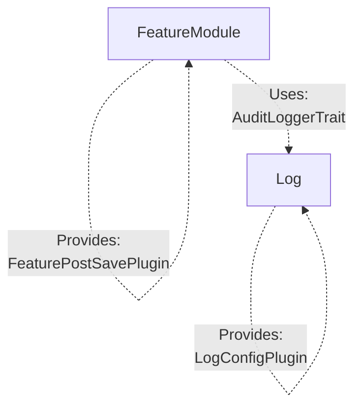
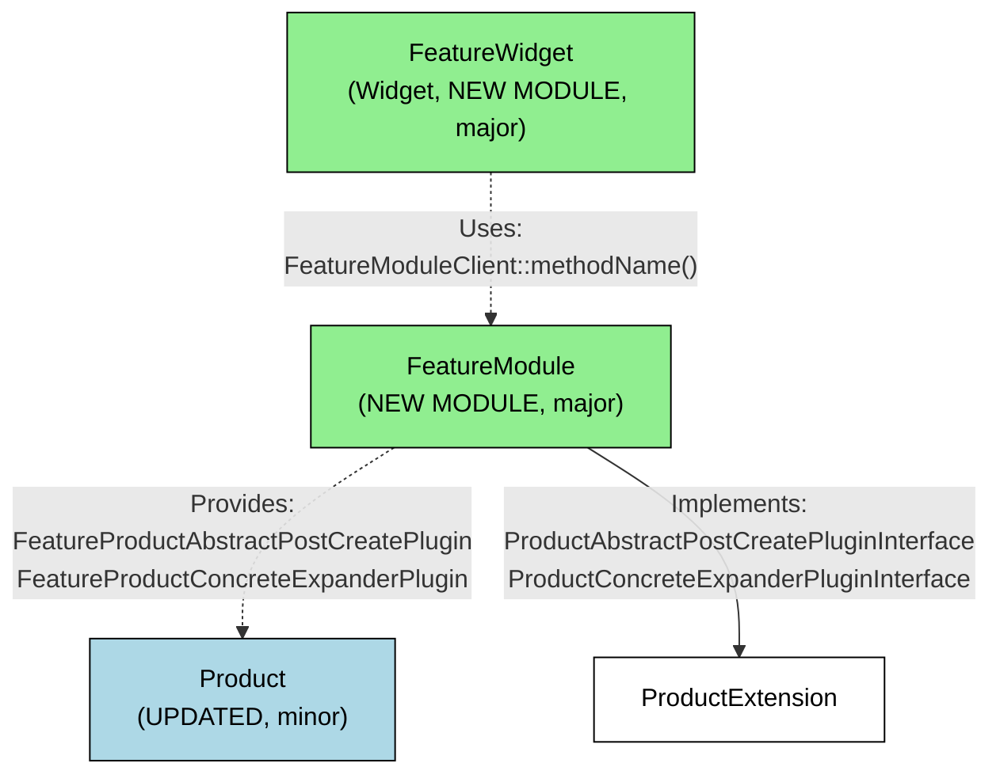

# Module Dependency Graph

## Purpose

Create the module architecture diagram in Mermaid for a Spryker technical specification. The diagram shows:
- The module relations and dependencies
- The plugin integrations (Provides and Implements)
- The module API that other modules use (Facade, Client and Service methods with `@api`)
- The new modules and the existing modules

## Output Format

- Embed the diagram in section 2.4 of the technical specification, or put it in a Markdown file.
- Create one diagram for each technical specification. Do not create more than one diagram.
- Add no explanatory text. Show only the diagram.

## Diagram Structure

### Mermaid Configuration



Do not use subgraphs or clusters in the diagram.

### Node Naming Conventions

- Use short IDs that are easy to remember (for example `FM`, `PRD`, `CART`).
- Write the full Spryker module name in the node label.
- Use `<br/>` for labels with more than one line.
- Add a descriptor in parentheses: `(NEW MODULE)`, `(Widget)`, `(UPDATED)`.
- **CRITICAL:** Show the expected release type in the label of each new or updated module: `(NEW MODULE, major)`, `(UPDATED, minor)`, `(UPDATED, patch)`.
  - A new module is `major` (first release 1.0.0).
  - For a `0.x` module, a BC break is `minor`.
  - Do not add a release type to a module that does not change.
  - A project-level (Pyz) node has no release. Write `(no release)`.

### Relationship Types

**CRITICAL RULES:**
1. Do not put more than one relationship type on one arrow. Show each relationship as a separate arrow.
2. Do not show a self-referencing relationship (MODULE to the same MODULE). See "Self-Referencing Relationships: NEVER ALLOW" below.

**Validation:** For each relationship `X -> Y` in the diagram:
- Make sure that X and Y are different module IDs.
- Make sure that the relationship crosses a module boundary.

#### Implements Relationships (Solid Lines)

Use this relationship when a plugin or class **implements** an interface:

```mermaid
MODULE -->|"Implements:<br/>PluginInterface"| ANOTHERMODULE
```

- MODULE - the module that contains the plugin
- ANOTHERMODULE - the module that contains the interface

**When to use:**
- A plugin implements an interface from a different module.
- A class extends an abstract class that implements a feature interface. Do not use it for framework classes.

#### Provides Relationships (Dashed Lines)

Use this relationship when a module **provides** a plugin implementation:

```mermaid
MODULE -.->|"Provides:<br/>PluginName"| ANOTHERMODULE
```

- MODULE - the module that contains the plugin
- ANOTHERMODULE - the module with the extension point in its DependencyProvider for the plugin

**When to use:**
- A module creates plugins for extension points.
- A module gives implementations that the project registers in dependency providers.

#### Uses Relationships (Dashed Lines)

Use this relationship when one module **uses functionality** from another module:

```mermaid
MODULE -.->|"Uses:<br/>AnotherModule{Facade,Client,Service}::methodName"| ANOTHERMODULE
```

- MODULE - the module that uses the API of ANOTHERMODULE

**When to use:**
- A plugin uses functionality from another module (for example a trait).
- A component calls Facade, Client or Service methods, or reads a config.

### Self-Referencing Relationships: NEVER ALLOW

**CRITICAL RULE:** A module MUST NEVER have an arrow to itself.

**Definition:** A self-referencing relationship occurs when:
- `MODULE_ID` -> `MODULE_ID` (the same node ID on the two sides)
- The source and the target are the same Spryker module
- Examples: `FM` -> `FM`, `LOG` -> `LOG`, `PRD` -> `PRD`

**Reasons for this rule:**
- The diagram shows the architecture **between** modules, not the structure **in** a module.
- A self-referencing relationship gives no architectural information.
- It makes the diagram larger and confuses the reader.
- Internal module calls (a Facade calls a Repository, a plugin uses a trait from the same module) are implementation details, not architecture.

**Validation rule:**
Before you complete a diagram, make sure that `X != Y` for each arrow `X -> Y`.

#### Wrong and Correct Examples

❌ **WRONG - Self-referencing:**


✅ **CORRECT - Only cross-module relationships:**


**Frequent mistakes:**
1. **A plugin provides to an extension point of its own module.** Do not show this. It is internal.
2. **A module uses its own Facade or Client.** Do not show this. It is internal.
3. **A Factory creates models in the same module.** Do not show this. It is internal.

**What to show:**
- A plugin from module A implements an interface in module B.
- A plugin from module A provides functionality to an extension point of module B.
- Module A uses a Facade, Client or Service from module B.

### Example: Frequent Mistakes

❌ **WRONG - Contains self-referencing relationships:**


**Problems in the diagram above:**
- `FM -> FM`: A plugin provides to an extension point of its own module (internal detail).
- `LOG -> LOG`: A config plugin provides to handlers of its own module (internal detail).
- Remove these arrows. Keep only `FM -> LOG`.

### Example: Correct Relationship Structure



### Color Coding

Add these styles at the end of the diagram:

```mermaid
%% New modules - the feature adds them
style NEW_MODULE fill:lightgreen,stroke:#000,color:#000

%% Existing modules with no changes (default)
style EXISTING_MODULE fill:white,stroke:#000,color:#000

%% Changed modules
style CHANGED_MODULE fill:lightblue,stroke:#000,color:#000

%% Widgets and frontend components with no changes
style WIDGET fill:#fff,stroke:#000,color:#000
```

## Constraints

### Critical Errors (Must Never Occur)
- **CRITICAL:** Do not draw self-referencing relationships (MODULE -> MODULE). See "Self-Referencing Relationships: NEVER ALLOW" above.
- **CRITICAL:** Do not put more than one relationship type on one arrow (for example "Provides & Implements").

### Other Constraints

- Add no explanatory text. Show only the diagram.
- Put the important information in the diagram labels.
- Show the expected release type (major, minor or patch) of each new or updated module.
- Show each relationship as a separate arrow.
- Use the color standards exactly as this file specifies.
- Do not create more than one diagram for the same module or feature.
- Do not add explanatory text after the diagram. Clear labels make the Mermaid diagram easy to understand.
