# Transfer Domain Model Diagram Guidelines

## Purpose

Create transfer object diagrams in Mermaid class diagram syntax for a Spryker technical specification. A transfer domain model diagram shows:
- The transfer object structure (properties and types)
- The relations between transfers (composition, aggregation, dependency)
- The data flow from source transfers to target transfers
- The query patterns (Criteria → Conditions)
- The collection patterns (Collection → Entity)
- The request and response patterns

## Output Format

- Embed the diagram as a `mermaid` block in section 2.6 of the technical specification, or put it in a `.mmd` file.
- Create one class diagram for each feature. Show all related transfers in it.
- Add no explanatory text to the diagram.

## Diagram Structure

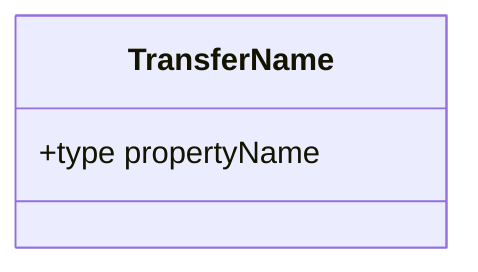

### Class Definition

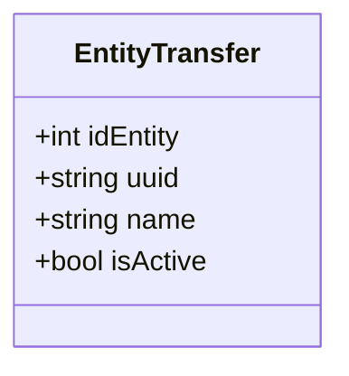

**Property syntax:**
- Format: `+type propertyName`
- Use the `+` prefix for all properties (public visibility).
- Write the type first, then the property name in camelCase.
- Do not use semicolons or method syntax.

**Naming conventions:**
- Transfer names: PascalCase with the "Transfer" suffix.
- Property names: camelCase, the same as in the Spryker transfer definitions.
- You can omit the "Transfer" suffix in the diagram to make it shorter.

### Supported Property Types

Use these Spryker transfer property types:

**Scalar types:**
- `int` - Integer numbers
- `string` - String values
- `bool` - Boolean flags
- `float` - Floating point numbers

**Array types:**
- `int[]` - Array of integers
- `string[]` - Array of strings
- `Type[]` - Array of transfer objects

**Transfer references:**
- `TransferName` - One nested transfer object
- `TransferName[]` - Array of transfer objects

**Examples:**
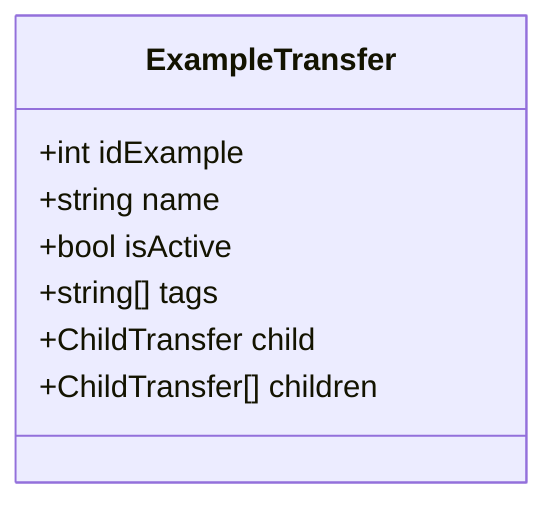

## Relationship Types

### Composition (Solid Arrow)

Use this arrow for a **contains** or **owns** relation, where the child cannot exist without the parent:

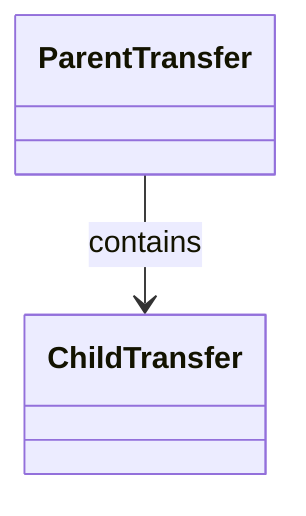

**When to use:**
- Collection → Entity
- Request → Entity
- Response → Entity
- Criteria → Conditions

**Syntax:**
```
TransferA --> TransferB : relationship label
```

### Dependency (Dashed Arrow)

Use this arrow for a **uses** or **references** relation, or for a data flow mapping:

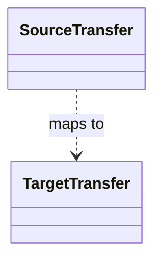

**When to use:**
- Data flow mappings
- Loose coupling, where the source uses the target but does not own it
- References across boundaries

**Syntax:**
```
TransferA ..> TransferB : relationship label
```

### Relationship Labels

Use clear and short labels:
- `contains` - Ownership or composition
- `contains multiple` - Ownership of an array or collection
- `uses` - Utility or reference
- `returns multiple` - Response collections
- `maps to` - Data flow or transformation
- `may contain` - Optional relation

**Examples:**
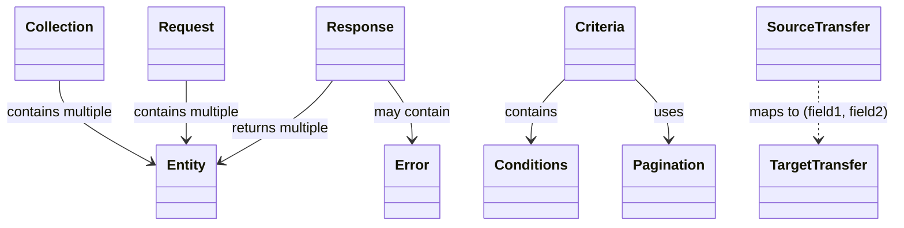

## Frequent Transfer Patterns

### Query Pattern (Criteria → Conditions)

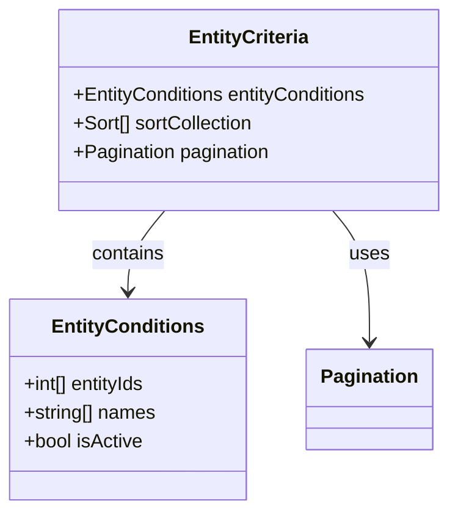

**Use:** Search and filter operations

### Collection Pattern (Collection → Entity)

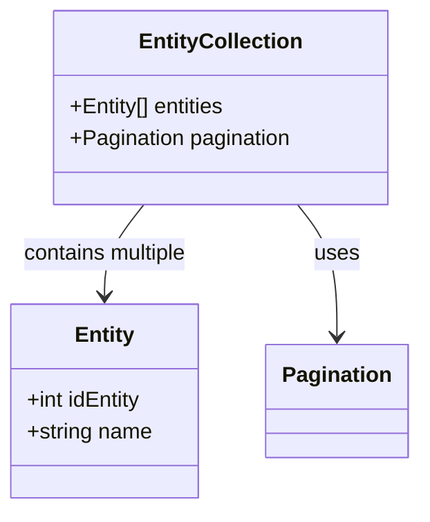

**Use:** Read operations that return more than one entity

### Request and Response Pattern

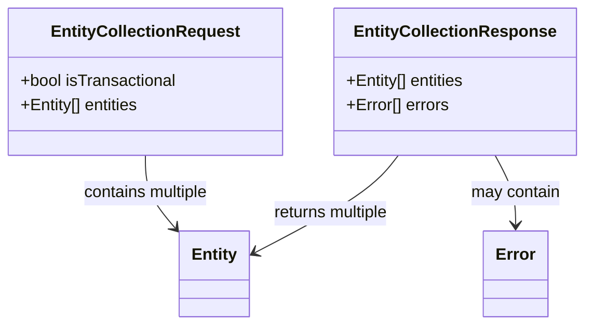

**Use:** Create and update operations with validation

### Data Flow Pattern (Source → Target)

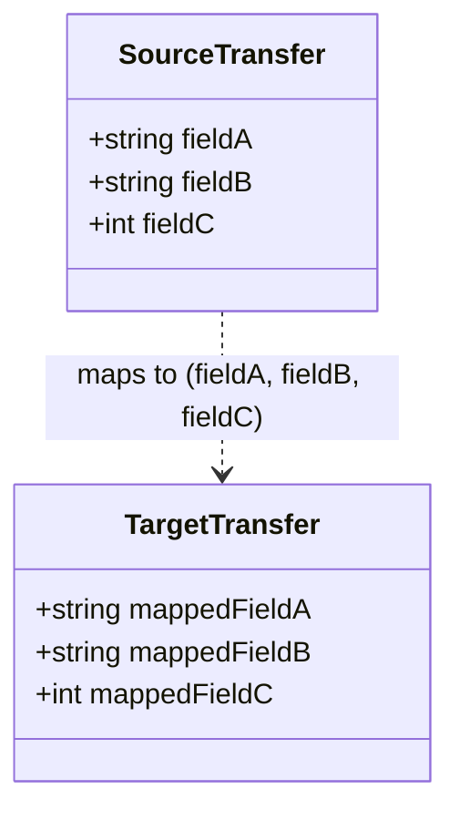

**Use:** Show how data goes from one transfer to a different transfer (for example, from an API request to a domain entity)

### Transfer Definitions

Do not add the transfer `.xml` to the specification. The diagram is the definition. Write only the transfer file path for each module. Use the real path of the module in the project, for example:

- **Core module** (installed with Composer): `vendor/spryker/module-name/src/Spryker/Shared/ModuleName/Transfer/module_name.transfer.xml`
- **Project module**: `src/Pyz/Shared/ModuleName/Transfer/module_name.transfer.xml`

Do not change files in `vendor/`. To add properties to a core transfer, use the project path. A repository that develops the core modules keeps them in `src/<Organization>/ModuleName/`, not in `vendor/`.

## Frequent Mistakes

### ❌ WRONG - Method Syntax

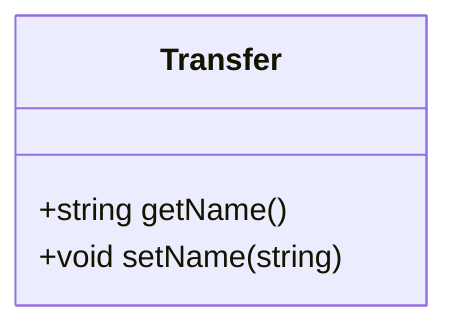

**Error:** Transfers are data structures, not classes with methods. Use only the property syntax.

### ✅ CORRECT - Property Syntax

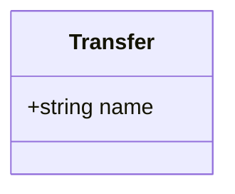

### ❌ WRONG - Bidirectional Arrows

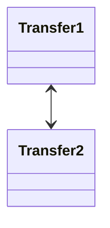

**Error:** A bidirectional arrow is not clear. Show the direction.

### ✅ CORRECT - Directional Arrows

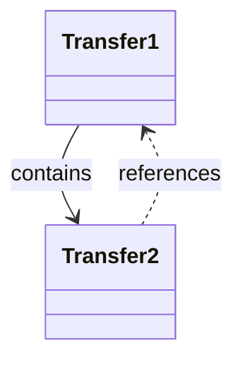

### ❌ WRONG - Complex Relationship Labels

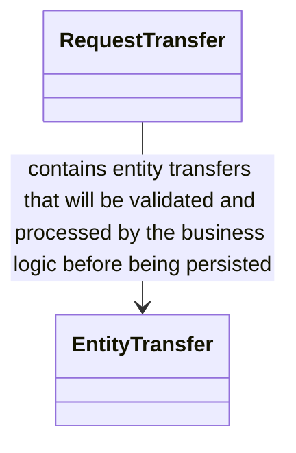

**Error:** Labels must be short. Long labels make the diagram difficult to read.

### ✅ CORRECT - Short Labels

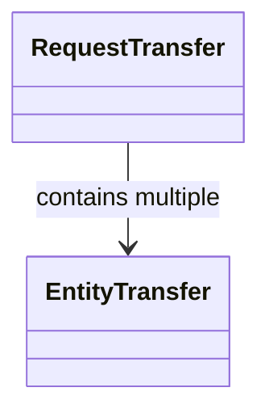

## Constraints

- Add no explanatory text around the diagram.
- Put the important information in the diagram labels.
- Below the diagram, write only the transfer file paths and short notes for property semantics.
