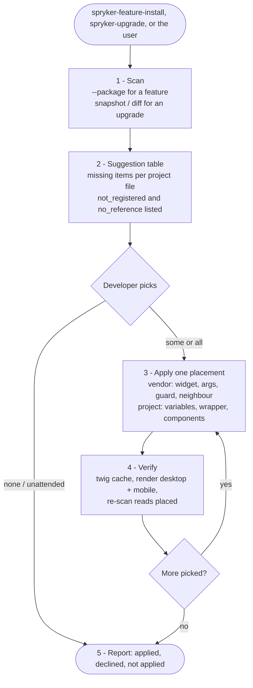

# yves-twig-integration

Optional storefront step for Spryker feature installs and upgrades. It suggests where a feature's Yves widgets and components belong in the project's own Twig templates and applies only the placements the developer picks.

Integration guides wire a feature's backend (plugins, config, schema) and leave Yves templates to the project. The vendor templates call the feature's widgets, but a project that overrides a vendor template (page layouts, header, footer, product item) renders its own copy, and the call is gone: the widget is registered and renders nothing.

## How it works

`scripts/yves-integration-scan.php` builds the template tree the project renders - project templates, vendor templates the project does not override, and the vendor blocks an extending override keeps (an `` block counts as the embedded component's) - and reports each widget or component as `placed`, `missing` (with the vendor call sites the project replaced), `not_registered` or `no_reference`. Plain PHP on the host, no Spryker boot; about a second on a demo shop.

The skill turns the `missing` items into a suggestion table, waits for the developer's pick, and places each picked item at the equivalent spot of the project template: the vendor decides what and where, the project decides how it looks ([references/placement-rules.md](references/placement-rules.md)).

## Flow schema

## Scripts

| Script | Use |
|---|---|
| `scripts/yves-integration-scan.php` | `scan` (default), `snapshot`, `diff`; `--package=`, `--module=`, `--json`. Writes `.ai-dev/yves-integration/report.json`. |
| `scripts/yves-integration-scan.test.php` | Zero-dependency tests on a generated fixture project: `php scripts/yves-integration-scan.test.php`. |
